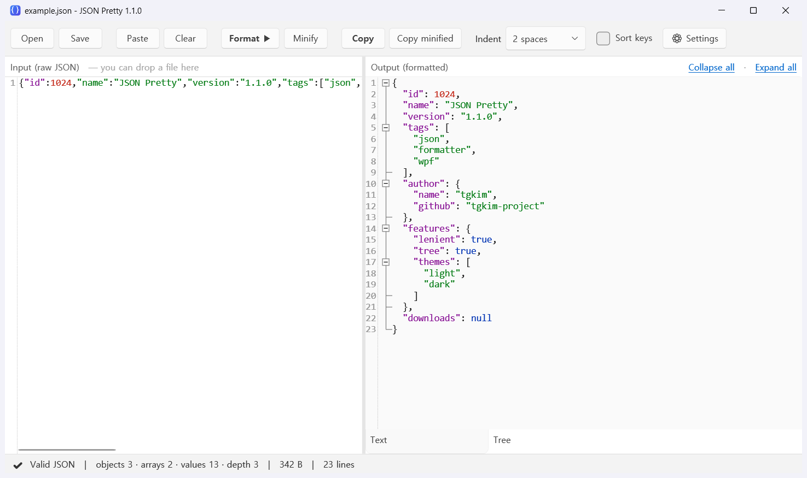
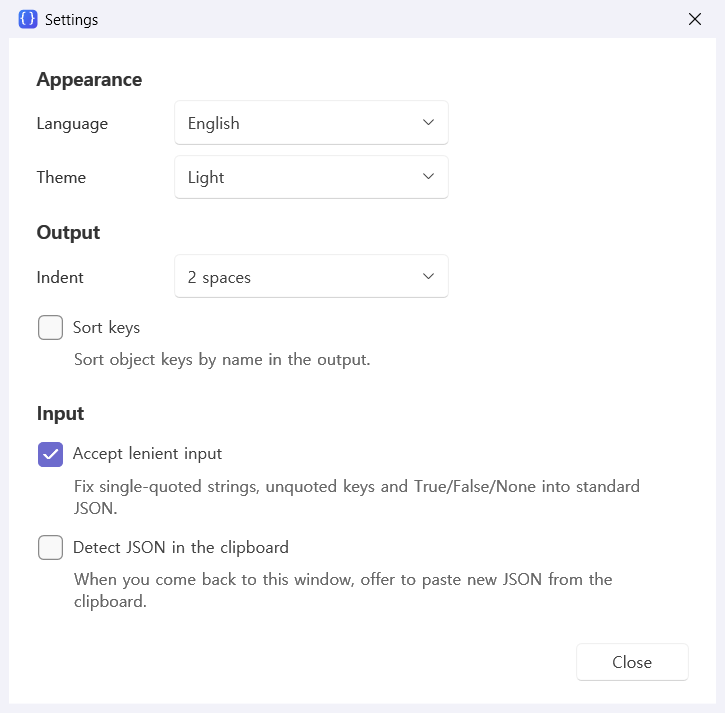

#  JSON Pretty

[](https://github.com/tgkim-project/json-pretty/releases/latest)
[](https://github.com/tgkim-project/json-pretty/releases)


[](https://github.com/tgkim-project/json-pretty/commits/main)
[](https://github.com/tgkim-project/json-pretty/actions/workflows/ci.yml)
[](LICENSE)

[한국어](README.md) | **English**

A Windows desktop app that pretty-prints, validates and copies messy JSON (WPF / .NET 9).



## Download

Get `JsonPretty.exe` from [**Releases**](https://github.com/tgkim-project/json-pretty/releases/latest) and run it.
It is a self-contained single file for Windows x64 — no .NET installation needed. The `JsonPretty.exe` in the repository root is the same file.

> [!NOTE]
> **If "Windows protected your PC" appears on first launch**
> The app is not code-signed, so Microsoft Defender SmartScreen may show a warning.
> Click **More info** → **Run anyway**; Windows won't ask again for that file.
> If you'd rather not run a downloaded binary, you can build it from source (see [Development](#development)).

## Features

- **Format / minify**: formats automatically 0.3 s after you type. 2 spaces, 4 spaces or tabs; optional key sorting. Numbers are kept exactly as written (big integers, `1.0`), and non-ASCII text is not escaped
- **Copy**: copy the formatted result, or copy it minified on one line
- **Error display**: for invalid JSON, the line is highlighted and the offending character underlined. Click the line/column message in the status bar to jump there
- **Lenient input**: fixes single-quoted strings, unquoted keys and `True/False/None` into standard JSON. JSON wrapped in a string, such as `"{\"a\":1}"` from logs, is unwrapped automatically
- **Folding / tree view**: collapse objects and arrays. The [Tree] tab shows node paths (`$.items[2].name`) and copies paths or values
- **Find**: `Ctrl+F` in the input and output panes (next `F3`, previous `Shift+F3`)
- **Files**: open and save, drag and drop onto the window, or pass a path like `JsonPretty.exe file.json` (up to 100 MB)
- **Clipboard detection**: when you copy JSON in another app and come back, it offers to paste it
- **Language**: 한국어 / English (switches instantly, no restart)
- **Theme**: System / Light / Dark

## Settings

Open **⚙ Settings** (`Ctrl+,`) in the toolbar to change the language, theme, and output and input options. Changes apply immediately and are saved — together with the window position and size — to `%APPDATA%\JsonPretty\settings.json`, then restored on the next start.



## Keyboard shortcuts

| Keys | Action |
|---|---|
| `Ctrl+O` | Open a file |
| `Ctrl+S` | Save the result to a file (UTF-8 without BOM) |
| `Ctrl+Enter` | Format |
| `Ctrl+Shift+V` | Paste the clipboard into the input |
| `Ctrl+Shift+C` | Copy the whole formatted result |
| `Ctrl+Alt+C` | Copy minified (one line) |
| `Ctrl+F` | Find |
| `Ctrl+,` | Settings |

## Development

Building requires the [.NET 9 SDK](https://dotnet.microsoft.com/download). See [DESIGN.md](DESIGN.md) (Korean) for the design notes.

```powershell
dotnet run --project src/JsonPretty.App   # run
dotnet test                               # test
```

### Release (update the exe)

```powershell
.\release.ps1 -Message "commit message" -Version 1.2.0 -Push -GitHubRelease
```

Runs tests → bumps the version → builds the self-contained exe → replaces `JsonPretty.exe` in the root → commits → pushes → creates GitHub Release `v1.2.0`.
Leave out `-Version` to keep the current version, and `-GitHubRelease` to leave Releases untouched.

- So that old exe files don't pile up in the repository, **older copies are removed from history and the branch is force-pushed**
  (commit hashes change, so clones on other machines need to be re-cloned).
- Releases also keep only the latest one: **the previous release and its tag are deleted**.
- GitHub Releases need the [GitHub CLI](https://cli.github.com/) (`gh`); run `gh auth login` once.
- UI text lives in `src/JsonPretty.App/Localization/Strings.cs` in both Korean and English. Add new text to both with the same key (a test checks this).

## License

[MIT](LICENSE)
