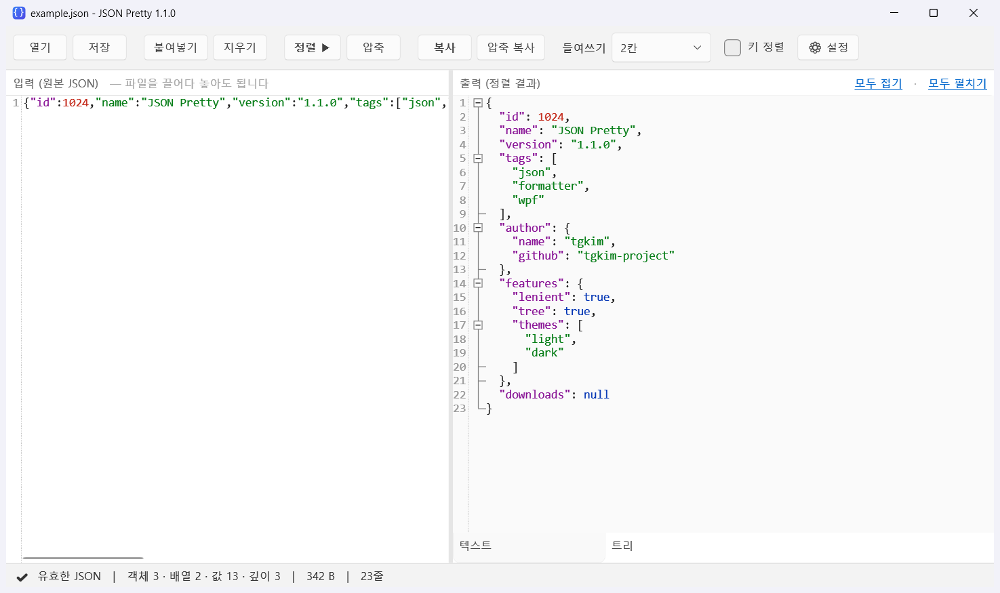
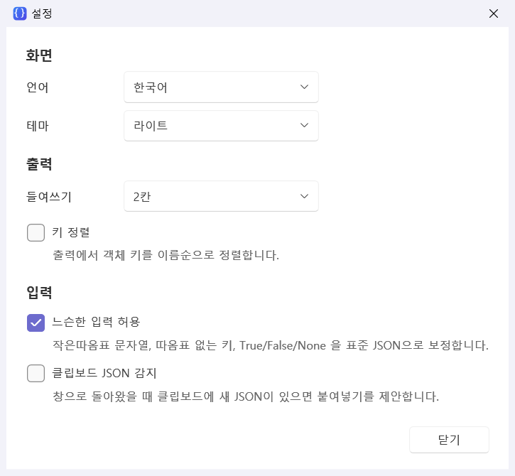

#  JSON Pretty

[](https://github.com/tgkim-project/json-pretty/releases/latest)
[](https://github.com/tgkim-project/json-pretty/releases)


[](https://github.com/tgkim-project/json-pretty/commits/main)
[](https://github.com/tgkim-project/json-pretty/actions/workflows/ci.yml)
[](LICENSE)

**한국어** | [English](README.en.md)

정돈되지 않은 JSON을 보기 좋게 정렬·검증·복사하는 Windows 데스크톱 프로그램입니다 (WPF / .NET 9).



## 다운로드

[**Releases**](https://github.com/tgkim-project/json-pretty/releases/latest)에서 `JsonPretty.exe` 를 내려받아 바로 실행하세요.
.NET 설치가 필요 없는 자체 포함 단일 파일(Windows x64)입니다. 저장소 루트의 `JsonPretty.exe` 도 같은 파일입니다.

> [!NOTE]
> **처음 실행할 때 "Windows의 PC 보호" 창이 뜨면**
> 코드 서명이 없는 프로그램이라 Microsoft Defender SmartScreen 경고가 나올 수 있습니다.
> 창에서 **추가 정보** → **실행**을 누르면 되고, 한 번 실행한 뒤에는 다시 묻지 않습니다.
> 내려받은 파일이 걱정되면 소스에서 직접 빌드할 수 있습니다 ([개발](#개발) 참고).

## 주요 기능

- **정렬 / 압축**: 입력하면 0.3초 뒤 자동으로 정렬. 들여쓰기 2칸·4칸·탭, 키 이름순 정렬. 숫자는 원문 그대로(큰 정수, `1.0` 보존), 한글은 이스케이프하지 않음
- **복사**: 정렬 결과 전체 복사, 한 줄로 압축해서 복사
- **오류 표시**: 잘못된 JSON은 입력 창의 해당 줄을 칠하고 오류 글자에 밑줄. 상태바의 줄/열 메시지를 클릭하면 그 위치로 이동
- **느슨한 입력 보정**: 작은따옴표 문자열, 따옴표 없는 키, `True/False/None` 을 표준 JSON으로 보정. 로그에서 흔한 `"{\"a\":1}"` 처럼 문자열 안에 든 JSON도 자동으로 풂
- **코드 접기 / 트리 보기**: 객체·배열 단위로 접기. [트리] 탭에서 노드 경로(`$.items[2].name`)와 값 복사
- **찾기**: 입력·출력 창에서 `Ctrl+F` (다음 `F3`, 이전 `Shift+F3`)
- **파일**: 열기·저장, 창에 끌어다 놓기, `JsonPretty.exe 파일.json` 처럼 실행 인자로 열기 (100 MB 이하)
- **클립보드 감지**: 다른 프로그램에서 JSON을 복사하고 돌아오면 붙여넣기를 제안
- **언어**: 한국어 / English (재시작 없이 바로 바뀜)
- **테마**: 시스템 / 라이트 / 다크

## 설정

툴바의 **⚙ 설정** (`Ctrl+,`)에서 언어, 테마, 출력·입력 옵션을 바꿀 수 있습니다. 바꾸는 즉시 적용되고, 창 위치·크기와 함께 `%APPDATA%\JsonPretty\settings.json` 에 저장되어 다음 실행 때 복원됩니다.



## 단축키

| 키 | 동작 |
|---|---|
| `Ctrl+O` | 파일 열기 |
| `Ctrl+S` | 정렬 결과를 파일로 저장 (BOM 없는 UTF-8) |
| `Ctrl+Enter` | 정렬 |
| `Ctrl+Shift+V` | 클립보드 내용을 입력에 붙여넣기 |
| `Ctrl+Shift+C` | 정렬 결과 전체 복사 |
| `Ctrl+Alt+C` | 한 줄로 압축해서 복사 |
| `Ctrl+F` | 찾기 |
| `Ctrl+,` | 설정 |

## 개발

빌드에는 [.NET 9 SDK](https://dotnet.microsoft.com/download)가 필요합니다. 설계는 [DESIGN.md](DESIGN.md) 참고.

```powershell
dotnet run --project src/JsonPretty.App   # 실행
dotnet test                               # 테스트
```

### 배포 (exe 갱신)

```powershell
.\release.ps1 -Message "커밋 메시지" -Version 1.2.0 -Push -GitHubRelease
```

테스트 → 버전 변경 → 자체 포함 exe 생성 → 루트 `JsonPretty.exe` 교체 → 커밋 → push → GitHub Release(`v1.2.0`) 생성 순서로 진행합니다.
`-Version` 을 빼면 지금 버전 그대로, `-GitHubRelease` 를 빼면 Releases는 건드리지 않습니다.

- 저장소에 예전 exe가 쌓이지 않도록 **이전 커밋들에서 예전 exe를 히스토리에서 지우고 강제 push**합니다
  (커밋 해시가 바뀌므로 다른 PC의 저장소는 새로 받아야 합니다).
- Releases도 **이전 릴리스와 태그를 지우고** 최신 하나만 남깁니다.
- GitHub Release에는 [GitHub CLI](https://cli.github.com/)(`gh`)가 필요하며, 처음 한 번 `gh auth login` 으로 로그인합니다.
- 화면 문구는 `src/JsonPretty.App/Localization/Strings.cs` 에 한국어·영어로 함께 있습니다. 새 문구는 양쪽에 같은 키로 넣으세요 (테스트가 확인).

## 라이선스

[MIT](LICENSE)
